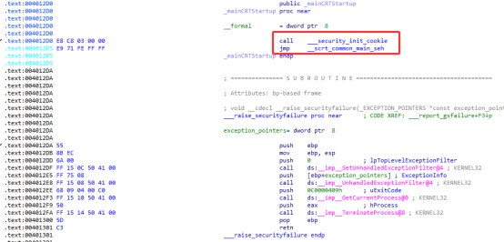
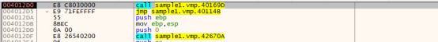
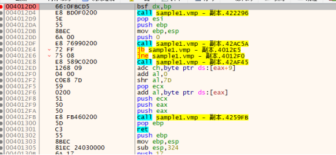
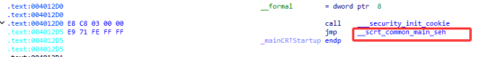
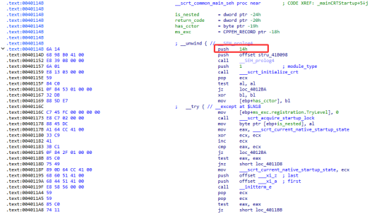
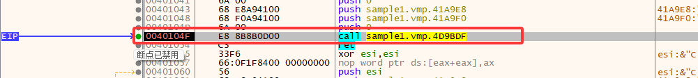
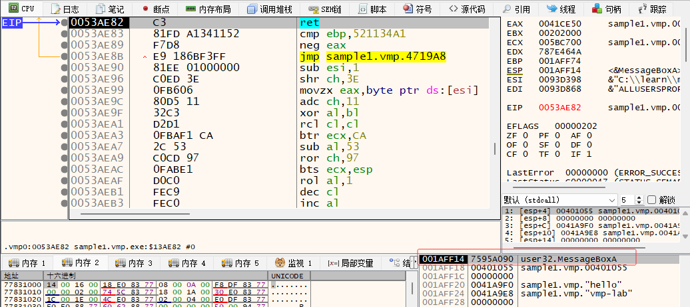

## VMP2.0

* 未加壳：



* 只有压缩壳



* 压缩壳并且虚拟化EntryPoint



### 只有压缩壳

压缩壳的作用是解压代码，并跳转到对应地址，如果OEP在`.text`段中，那么壳代码在解压缩之后会修改`.text`段的属性为可执行，再跳转到到OEP，并且OEP的寄存器数据与EP(壳代码入口)相同，对抗思路也很简单了

1. VMP为了执行的稳定性，壳代码会将寄存器数据保存，跳转到OEP前恢复，这样可以跟踪寄存器的数据（比如添加魔术字），检测到相同寄存器数据后，基本可以确定是OEP地址

2. `.text`段的默认不可执行，并且全0，执行前会将解压缩后的代码复制到原位置，并且使用`VirtualProtect`函数设置`.text`段的属性为可执行，跟踪`VirtualProtect`的调用，一般来说`VirtualProtect`后就会调转到`.text`段

```text
VirtualProtect: lpAddress=0x401000 dwSize=136CE flNewProtect=4 lpflOldProtect=1AFF4C
VirtualProtect: lpAddress=0x415000 dwSize=6D6C flNewProtect=4 lpflOldProtect=1AFF4C
VirtualProtect: lpAddress=0x41F000 dwSize=1E0 flNewProtect=4 lpflOldProtect=1AFF4C
VirtualProtect: lpAddress=0x420000 dwSize=109C flNewProtect=4 lpflOldProtect=1AFF4C
VirtualProtect: lpAddress=0x422000 dwSize=A6E1 flNewProtect=4 lpflOldProtect=1AFF4C
VirtualProtect: lpAddress=0x401000 dwSize=136CE flNewProtect=20 lpflOldProtect=1AFF4C
VirtualProtect: lpAddress=0x415000 dwSize=6D6C flNewProtect=2 lpflOldProtect=1AFF4C
VirtualProtect: lpAddress=0x41F000 dwSize=1E0 flNewProtect=20 lpflOldProtect=1AFF4C
VirtualProtect: lpAddress=0x420000 dwSize=109C flNewProtect=20 lpflOldProtect=1AFF4C
VirtualProtect: lpAddress=0x422000 dwSize=A6E1 flNewProtect=20 lpflOldProtect=1AFF4C
VirtualProtect: lpAddress=0x41E000 dwSize=80 flNewProtect=2 lpflOldProtect=1AFF08
VirtualProtect: lpAddress=0x41E000 dwSize=80 flNewProtect=4 lpflOldProtect=1AFEF0
VirtualProtect: lpAddress=0x41E000 dwSize=80 flNewProtect=2 lpflOldProtect=1AFEF0
VirtualProtect: lpAddress=0x41E000 dwSize=80 flNewProtect=4 lpflOldProtect=1AF240
VirtualProtect: lpAddress=0x41E000 dwSize=80 flNewProtect=2 lpflOldProtect=1AF240
VirtualProtect: lpAddress=0x41E000 dwSize=80 flNewProtect=4 lpflOldProtect=1AFC7C
VirtualProtect: lpAddress=0x41E000 dwSize=80 flNewProtect=2 lpflOldProtect=1AFC7C
```

### 压缩并且虚拟化EntryPoint

如果虚拟化`EntryPoint`，就比较特殊了，程序不会跳转到`.text`段的OEP，而是会顺着虚拟机指令一直执行，但是`__scrt_common_main_seh`依然会被执行：




这样会导致跟踪时找不到OEP，或者说OEP在虚拟机中，不能直接定位，但是依然可以定位`__scrt_common_main_seh`和`main`。

对于其他语言的编译产物，`CRT`的`_start`可能不同，比如`ELF`的`libc _start`和`PE`的`_mainCRTStartup`，看具体情况。

## VMP3.0.9

大体上与2.0类似，如果虚拟化EntryPoint，EntryPoint会执行（与VMP2.0不同）。

```text
irtualProtect: lpAddress=0x41F000 dwSize=0x18129E flNewProtect=0x40 lpflOldProtect=0x1AFEFC
VirtualProtect: lpAddress=0x401000 dwSize=0x136CE flNewProtect=0x40 lpflOldProtect=0x1AFEFC
VirtualProtect: lpAddress=0x415000 dwSize=0x6D6C flNewProtect=0x4 lpflOldProtect=0x1AFEFC
VirtualProtect: lpAddress=0x445000 dwSize=0x521C flNewProtect=0x4 lpflOldProtect=0x1AFEFC
VirtualProtect: lpAddress=0x15A0000 dwSize=0x1000 flNewProtect=0x20 lpflOldProtect=0x1AF3B8
VirtualProtect: lpAddress=0x41F000 dwSize=0x18129E flNewProtect=0x20 lpflOldProtect=0x1AFF0C
VirtualProtect: lpAddress=0x401000 dwSize=0x136CE flNewProtect=0x20 lpflOldProtect=0x1AFF0C
VirtualProtect: lpAddress=0x415000 dwSize=0x6D6C flNewProtect=0x2 lpflOldProtect=0x1AFF0C
VirtualProtect: lpAddress=0x445000 dwSize=0x521C flNewProtect=0x4 lpflOldProtect=0x1AFF0C
```

## DUMP

可以直接DUMP OEP，如果虚拟化EntryPoint，可以尝试让`__scrt_common_main_seh`作为OEP，否则应该修复栈，因为压缩壳中会初始化虚拟机依赖的数据，直接使用`虚拟化的EntryPoint`会因为没有初始环境而崩溃。

## IAT修复

目前的思路是模拟执行，VMP3.0的DLL调用特征是call一个函数：



接着通过简单的数值计算（计算过程没有复杂调用）算出Dll函数的地址，通过ret调转到对应函数：



---

::: tip 版权声明
本文版权归 [lee0xb1t](https://github.com/lee0xb1t) 所有，未经许可不得以任何形式转载。
:::
